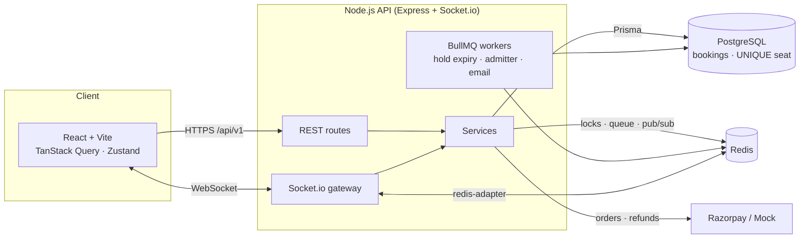

<div align="center">

# 🎟️ RushPass

**Get in before the rush.**

A real-time ticket booking platform for high-demand events, with **live multiplayer group booking**, a **fair waiting room for ticket drops**, and a **zero-double-booking guarantee** proven under load.


</div>

---

## Screenshots

> Add your own screenshots here after running the app (`docs/` folder works well).

| Home | Group room | Waiting room |
|---|---|---|
| `docs/home.png` | `docs/group-room.png` | `docs/waiting-room.png` |

| Seat map | E-ticket | Rush monitor |
|---|---|---|
| `docs/seats.png` | `docs/ticket.png` | `docs/rush-monitor.png` |

---

## ✨ Features

### ⭐ Star feature 1 — Live Group Booking Room
- Tap **“With friends”** on any show to create a room with a 6-letter code and share link.
- Up to **8 friends** join and pick seats on the **same live seat map**, each in their own colour, with **live cursors**, presence dots, an activity feed and chat with emoji reactions.
- One shared **7-minute timer** holds every seat; the host can extend it once (+2 min), kick members, or cancel.
- The host **locks in**, then everyone pays **only their own share** with a live ✅ / ⏳ payment board.
- When the timer ends, **only unpaid seats are released** — friends who paid keep their tickets (partial success).

### ⭐ Star feature 2 — Fair Waiting Room for Drops
- Organisers mark a show as a **Drop** with a sale-open time and an admit rate.
- Everyone who arrives **before** the sale gets a **random** place in line (no advantage for a faster connection); later arrivals queue in order.
- Live position, people ahead/behind, estimated wait and a progress bar, updated over WebSockets.
- A background worker admits users in batches and issues a signed **10-minute admission token**; only admitted users can lock seats.
- One spot per account, per-IP rate limits, and refreshing keeps your position.

### Core
- JWT auth (15-min access token + rotating httpOnly refresh cookie with reuse detection), 4 roles.
- Real-time SVG seat map: zoom, pinch, arrow-key navigation, tier colours, live updates for every viewer.
- Atomic multi-seat locking in Redis (Lua), max 8 seats per user, 5-minute hold with a visible countdown.
- Checkout with **Razorpay test mode** or a built-in **mock gateway** (works with zero keys), HMAC signature checks, **Idempotency-Key** support, automatic refunds when a hold expired mid-payment.
- QR e-tickets (signed JWT), PDF download, email with the PDF attached, confetti 🎉.
- Cancellation with refund up to 24h before the show.
- Staff **check-in scanner** (camera or pasted code) with big green/red result screens and sounds.
- Organiser studio: event & show management, **visual seat-map builder**, live occupancy heatmap, revenue and tier charts.
- Admin: platform stats, user role management, and the **Live Rush Monitor** for demos.
- Dark-first “midnight concert” design with a polished light mode, fully responsive and accessible.

---

## 🏗️ Architecture



```
rushpass/
├─ apps/api        Express + Socket.io + Prisma + BullMQ  (routes → services → prisma)
│  ├─ prisma/      schema, migrations, seed
│  ├─ src/lib/     redis, Lua locks, payments (strategy pattern), mail, QR/PDF, idempotency
│  ├─ src/services holds · groups · queue · checkout · bookings · events · venues · dashboards
│  └─ tests/       Vitest + Supertest (incl. concurrency tests)
├─ apps/web        React + Vite + Tailwind + Framer Motion
├─ packages/shared Types, zod schemas, socket event names, seat-layout generator, pricing
└─ load-tests/     k6 booking rush
```

---

## 🛡️ How “no double booking” is guaranteed

Three independent layers, each of which would stop a double sale on its own:

1. **Redis atomic locks (fast path).** Picking seats runs a Lua script that checks *every* requested seat and then sets them all with `SET seat:{show}:{seat} {holdId} PX 300000` — **all or nothing**, in one atomic step. 50 people clicking the same seat at the same millisecond → exactly one wins.
2. **Row locks at payment time.** Confirming a booking runs inside a Postgres transaction that does `SELECT … FOR UPDATE` on the booking and seat rows, and re-checks that the Redis hold still belongs to this booking.
3. **Database constraint (last line of defence).** `BookingSeat` has `UNIQUE(showId, seatId)`. Even if Redis were bypassed entirely, Postgres refuses the second insert; the loser is **automatically refunded**.

The test suite proves each layer (`apps/api/tests/holds.test.ts`, `booking.test.ts`), and the k6 load test ends by counting duplicates in the database.

## 🚦 How the waiting room works

```
join → ZADD NX queue:{show} score userId     (NX = one spot per account)
        score = saleOpen + random(0..60s)    if you arrived before the sale (fair shuffle)
        score = now + 60s                    if you arrived after (always behind early birds)
every 5s → ZPOPMIN admitPerMinute/12 users → sign admission JWT → SET admit:{show}:{user} EX 600
         → emit queue:admitted to that user, queue:tick to everyone else
seat lock → rejected with 403 NOT_ADMITTED unless admit:{show}:{user} exists
```

---

## 🚀 Run it locally

**Prerequisites:** Node.js 20+, Docker Desktop.

```bash
git clone <your-repo-url> rushpass && cd rushpass
npm install
npm run db:up                                   # Postgres + Redis in Docker
cp apps/api/.env.example apps/api/.env          # defaults work as-is locally
npm run db:migrate                              # create tables
npm run seed                                    # demo data
npm run dev                                     # API :4000 + web :5173
```

Open **http://localhost:5173**.

> If `npm install` warns that install scripts were blocked (npm 11+), run `npm approve-scripts` and approve `prisma`, `@prisma/*`, `esbuild` and `msgpackr-extract`.

### Demo accounts (password for all: `Password@123`)

| Role | Email |
|---|---|
| Admin | `admin@rushpass.dev` |
| Organizer | `organizer@rushpass.dev`, `organizer2@rushpass.dev` |
| Staff (check-in) | `staff@rushpass.dev` |
| Users | `user@rushpass.dev`, `user2@rushpass.dev` … `user10@rushpass.dev` |

The seed creates 3 venues (300-seat theatre, 120-seat club, 500-seat arena with a VIP pit), 12 events across Mumbai, Bengaluru and Delhi, ~800 existing bookings, and one **Drop** whose sale opens **5 minutes after seeding**.

### Try the star features
- **Group room:** log in as `user@…` in one browser and `user2@…` in a private window. Open an event → *With friends* → copy the code → join from the other window. Pick seats in both and watch them appear live.
- **Waiting room:** open *Starlight Arena Tour — Ticket Drop* → *Join queue* with a few accounts before the sale opens.
- **Check-in:** book a ticket, log in as `staff@…`, open *Check-in* and paste the ticket code (or scan the QR with your phone pointed at the screen).

### Scripts

| Command | What it does |
|---|---|
| `npm run dev` | API (tsx watch) + web (Vite) together |
| `npm run build` | Production build of both apps |
| `npm test` | API test suite (needs `npm run db:up`) |
| `npm run lint` / `npm run typecheck` | ESLint / TypeScript |
| `npm run seed` | Reset and seed the database |
| `docker compose --profile app up --build` | Run the full stack in containers (web on :8080) |

---

## 🔥 Load test (the demo moment)

```bash
# 1. restart the API with rate limits raised (all k6 traffic comes from one IP)
RATE_LIMIT_MAX=1000000 AUTH_RATE_LIMIT_MAX=1000000 npm run dev -w apps/api
# 2. open http://localhost:5173/admin/rush-monitor as admin
# 3. copy a show id from any seat-map URL (/shows/<id>/seats) and run:
k6 run -e API_URL=http://localhost:4000 -e SHOW_ID=<id> load-tests/booking-rush.js
```

1000 virtual users fight over the same 40 seats. Watch locks/sec, rejections and bookings climb on the monitor while **Double bookings** stays at **0**. The script prints the final count at the end.

---

## ☁️ Deploy (free tiers)

1. **Neon** → create a project → copy the Postgres connection string as `DATABASE_URL`.
2. **Upstash** → create a Redis database → copy the `rediss://…` URL as `REDIS_URL`.
3. **Render** → *New Web Service* from your GitHub repo (or *New → Blueprint* using `render.yaml`):
   - Build: `npm ci --include=dev && npm run build -w apps/api && npx --workspace apps/api prisma migrate deploy`
   - Start: `npm run start -w apps/api`
   - Env: `NODE_ENV=production`, `DATABASE_URL`, `REDIS_URL`, `CLIENT_URL` (set in step 5), and four secrets `JWT_ACCESS_SECRET`, `JWT_REFRESH_SECRET`, `TICKET_QR_SECRET`, `ADMISSION_SECRET` (`openssl rand -hex 32` each).
   - Seed once from the Render shell: `npm run seed`
4. **Vercel** → import the repo → **Root directory** `apps/web` → env `VITE_API_URL` and `VITE_SOCKET_URL` = your Render URL (e.g. `https://rushpass-api.onrender.com`).
5. Back on Render, set `CLIENT_URL` to your Vercel URL. In production cookies use `SameSite=None; Secure`, so both sites must be HTTPS (they are by default).

Optional: add Razorpay **test** keys (`RAZORPAY_KEY_ID`, `RAZORPAY_KEY_SECRET`, `RAZORPAY_WEBHOOK_SECRET` on Render and `VITE_RAZORPAY_KEY_ID` on Vercel) and point a Razorpay webhook at `https://<api>/api/v1/webhooks/razorpay`. Without keys, the mock gateway is used.

> Render’s free tier sleeps after inactivity, so the first request can take ~30s. Open the site a minute before your demo.

---

## 🧪 Tests

```
✓ auth flow             register, refresh-token rotation, reuse detection, validation
✓ seat locking          all-or-nothing · 50 parallel requests → exactly 1 succeeds · per-user cap
✓ checkout + booking    end-to-end mock payment · idempotent orders · forged signatures rejected
                        20 parallel confirms → 1 booking · Redis bypassed → UNIQUE stops it, 9 refunds
                        cancellation frees seats
✓ group room            split payment partial success on expiry · extend once · kick
✓ waiting room          admission order · gating before admission · before sale opens
```

---

## 📚 API overview

Base path `/api/v1`. Errors are always `{ error: { code, message, details } }`; lists are `{ data, meta: { page, pageSize, total } }`.

| Area | Endpoints |
|---|---|
| Auth | `POST /auth/register` `POST /auth/login` `POST /auth/refresh` `POST /auth/logout` `GET/PATCH /auth/me` |
| Events | `GET /events` `GET /events/:slug` `POST /events` `PATCH /events/:id` `DELETE /events/:id` `POST /events/:id/shows` |
| Shows | `GET /shows/:id` `GET /shows/:id/seats` `PATCH /shows/:id` |
| Holds | `POST /shows/:id/holds` `GET /shows/:id/holds/me` `GET /holds/:id` `POST /holds/:id/release` `DELETE /holds/:id` |
| Queue | `POST /shows/:id/queue/join` `GET /shows/:id/queue/status` |
| Groups | `POST /groups` `GET /groups/:code` `POST /groups/:code/join` `…/lockin` `…/extend` `…/chat` `DELETE /groups/:code/members/:userId` `DELETE /groups/:code` |
| Checkout | `POST /checkout/orders` (Idempotency-Key) `POST /checkout/confirm` `POST /checkout/mock/:orderId/pay\|fail` `POST /webhooks/razorpay` |
| Bookings | `GET /bookings/me` `GET /bookings/:id` `POST /bookings/:id/cancel` `GET /bookings/:id/tickets.pdf` |
| Venues | `GET/POST /venues` `GET /venues/:id` `PUT /venues/:id/layout` |
| Staff | `POST /checkin/verify` |
| Dashboards | `GET /organizer/stats` `GET /organizer/shows/:id/occupancy` `GET /admin/stats` `GET /admin/users` `PATCH /admin/users/:id/role` `GET /admin/rush-monitor` |
| Health | `GET /health` |

Socket.io rooms: `show:{id}`, `group:{code}`, `queue:{showId}`, `user:{id}`. Event names live in `packages/shared/src/index.ts`.

---

Built as a final-year B.Tech CSE project. Payments run in test mode only.
